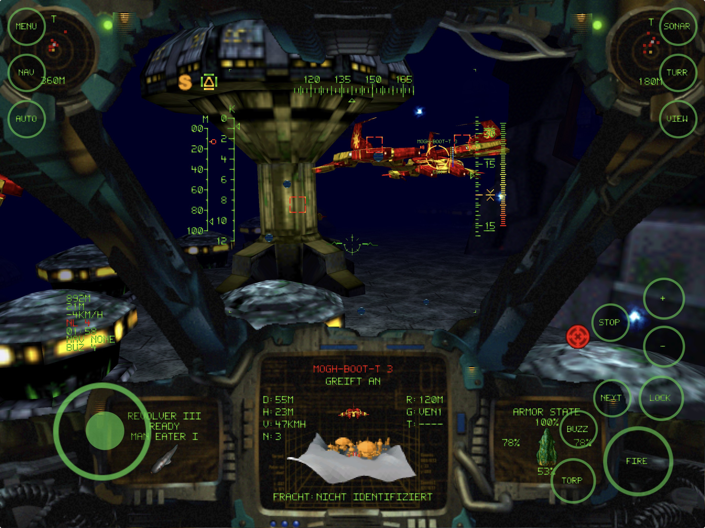

# Vertigo
In November 1996, „[Archimedean Dynasty](https://en.wikipedia.org/wiki/Archimedean_Dynasty)“ - or better known under its original German title "[Schleichfahrt](https://de.wikipedia.org/wiki/Schleichfahrt_%28Computerspiel%29)" - was released by *Massive Development*.
This repository contains an open-source clone with the goal to faithfully recreate this 30 year old classic. It is based on the original work from [github.com/pnordhus/vertigo](https://github.com/pnordhus/vertigo), where many parts had already been reimplemented years ago but then abandoned mid-finished.
With the help of Claude Code, most open TODOs and missing features could finally be implemented, bringing the codebase closer to its original. In addition, an iPad version was created as well as a feasibility study to enable real 3D cockpits for an eventual VR port. 
The game is now portable and playable on current hard and software in modern resolutions, improving the look (eg. by upscaling) but keeping its style and oldschool graphics.  For copyright reasons, the repository does not contain any old game data or binaries, the game assets from an original version of the game (either English or German), from an old CD or GOG installation, are required.
This implementation in its current form can be considered **90% done**:
* Modern codebase and renderer that support compiling for multiple platforms (macOS, iOS (iPad), Windows, Linux - the latter two untested)
* Import of English and German original or [modified](https://www.moddb.com/mods/archimedean-dynasty-augmented-mod) game data 
* Menus, stations and interactions (dialogs, dock, upgrades), notebook, movies, music all work
* Missions are playable and story can be progressed
* For input, Keyboard and Controllers are supported (as well as touch on the iPad)
* Experimental: 3D cockpits, also making true support for widescreen aspect ratios possible

What's missing are the details:
* HUD behaviour and sound/voice lines for different situations (radioactive etc.)
* Game behaviour that couldn't be derived from the game data (currents, engine/power, ...)
* Weapons effects as in the original
* 3rd person and external view when destroyed
* Minor screens like ingame log and help

# Compiling
Vertigo needs SDL 3, OpenAL and GLM, and draws with OpenGL 3.2 (core profile)
or OpenGL ES 3. The build also has tests of the game's own types for text,
data values, images, JSON and CD images (`ctest`).

```
mkdir build
cd build
cmake ..
make
```

## Linux (Nix)

If you use Nix with flakes enabled, you can build and start Vertigo by running:
```
nix run github:pnordhus/vertigo
```

## macOS (Homebrew)

```
brew install cmake sdl3 glm
mkdir build
cd build
cmake -DCMAKE_BUILD_TYPE=RelWithDebInfo ..
make
```

## iPad



The iPad version needs Xcode, CMake 3.24 or newer and GLM's headers
(`brew install cmake glm`), and runs on iPadOS 18.6 or later. CMake downloads
SDL's source release (checked against its SHA-256) and builds it for iOS;
OpenAL and OpenGL ES are the system's.

```
cmake -S . -B build-ios -G Xcode -DCMAKE_SYSTEM_NAME=iOS
cmake --build build-ios --config Release -- -sdk iphonesimulator
xcrun simctl install booted build-ios/Release/Vertigo.app
```

builds the app for the simulator and installs it there. For an iPad, open
`build-ios/vertigo.xcodeproj` in Xcode and choose a team for signing, or pass
`-DVERTIGO_DEVELOPMENT_TEAM=<team ID>` (and if needed
`-DVERTIGO_BUNDLE_ID=<identifier>`) to the first command and build with
`-sdk iphoneos -allowProvisioningUpdates`. Xcode's `vertigo` scheme runs the
optimised RelWithDebInfo build: a pure Debug build runs significantly slower and is not 
recommended to run the game.

The game data goes into Vertigo's folder in the Files app (On My iPad ›
Vertigo), which the Finder also shows when the iPad is connected to a Mac.
Copy a GOG installation of the game there, and Vertigo builds the game data
from its CD image `game.gog` and the installed files, in the folder `Game Data`
(580 MB, kept out of iCloud backups); then the installation can go. The game
data itself (see below) works too, directly in Vertigo's folder or in a folder
of its own. In the simulator, copy it into the app's container:

```
cp -R <GOG installation or game data> "$(xcrun simctl get_app_container booted com.vertigo.Vertigo data)/Documents/"
```

Test mode takes its options there too, e.g.
`xcrun simctl launch booted com.vertigo.Vertigo s00101 --timeout 60`. The
simulator renders OpenGL ES in software: the 3D cockpit is too slow there, and
now and then a triangle close to the camera goes missing.

Missions are played by touch, with a hardware keyboard or with a game
controller (see below). On keyboards without Esc and function keys, Cmd+. is
Esc and Cmd with the number row's 1 to 0, - and = is F1 to F12 (on
every system; Ctrl on Windows and Linux); iPadOS can also make Caps Lock an
Esc key (Settings › General › Keyboard › Hardware Keyboard › Modifier Keys).
The on-screen keyboard comes up for a new game's name, which moves above it.

When the app is interrupted (a call, Siri, the app switcher) or goes to the
background, a mission pauses; P, or continuing from the mission menu, goes
on. The game's sound
mixes with other apps' audio, such as music, and is silent with the silent
switch.

## Game data

Vertigo needs the complete game data, including the movies. A GOG installation
only contains part of it; the rest is in the CD image (`game.gog`, a raw
`MODE1/2352` track). Point Vertigo to a directory containing `DAT`, `GFX`,
`SFX`, `TXT` and `VFX` from the CD's `SF` directory, with the installed files
copied on top. The case of the file names doesn't matter, also on file systems
that tell upper and lower case apart. Vertigo asks for the directory at the
first start, and again whenever the remembered one lacks part of the data.
Given a GOG installation, or a directory with a CD image of the game (`.iso`,
or `.bin` of a `MODE1/2352` track), it offers to build that directory itself,
as `Game Data` next to the saved games. `--data <directory>` uses another
directory for one run, without remembering it.

The missions' music is the CD's audio tracks 2 to 5. Building `Game Data`
also copies them out of the image (or, for a rip with a file for each track,
by its `.cue`), as `SFX/CD/TRACK02.WAV` to `TRACK05.WAV` (98 MB); a directory
put together by hand can have them there too. Game data built before this
version lacks them: delete `Game Data` and build it again. The notebook's
Options › Sound, or the main menu's Options, turns the music off and on, as
the original's "CD Musik" did.

## Game controllers

Missions can be played with a game controller (Xbox, PlayStation, Switch Pro
or MFi controllers, through SDL), on the desktop and on the iPad. The buttons
are named after an Xbox controller's here. The left stick steers as far as it
is pushed; as with the original's joystick, forward lowers the nose. The
buttons stand for the keys in brackets, and LB held gives a second set:

| Control | In a mission | With LB held |
|---|---|---|
| Left stick | steer | |
| Right stick | look around in the 3D cockpit | |
| RT | fire the gun (Space) | |
| LT | fire a torpedo (Tab) | |
| RB | lock the target in the reticle (L) | |
| A | lock the nearest enemy (U) | autopilot (Alt+A) |
| B | drop a buzzer (D) | engine on or off (the key left of 1) |
| X | next torpedo (Enter) | debug overlay (Ctrl+D) |
| Y | next nav point (N) | lock the nav point (Alt+N) |
| D-pad up | 10 km/h faster, again and again while held (S) | the weapon page: gun, magazine, turrets in turn (F1–F4) |
| D-pad down | 10 km/h slower, the same (X) | armor and systems page (I) |
| D-pad left | stop (C) | the booster, while held (Q) |
| D-pad right | sonar on or off (R) | sonar zoom (Alt+R) |
| L3, R3 (press a stick) | full ahead, full astern while held (A, Z) | |
| Start | mission menu (Esc) | pause (P) |
| Back | turret menu (O) | 2D or 3D cockpit (Alt+V) |

In the mission and turret menus the d-pad highlights an option, A takes it and
B goes back. Elsewhere A is Return, B and Start are Esc: any button starts a
mission after its briefing, B or Start skips a movie, A confirms a new game's
name. Menus and stations take the mouse, or touch on the iPad.

## Touch controls

On a touch screen (the iPad) missions show controls of their own over the
cockpit: from the start when neither a keyboard nor a game controller is
connected, otherwise once the screen is touched. A key or a controller's
button hides them again.

- A finger on the left part of the screen brings up a stick where it comes
  down; it steers as far as it is pushed (up lowers the nose).
- Under the right thumb: FIRE (held), and around it TORP (fire a torpedo),
  BUZZ (drop a buzzer), NEXT (the next torpedo) and LOCK (the nearest enemy);
  above them + and - change the speed by 10 km/h (again and again while held),
  and STOP stops.
- In the corners: MENU (the mission menu, when the finger is lifted; held for
  a second it shows or hides the debug overlay instead), NAV (the next nav
  point), AUTO (autopilot), SONAR (on or off), TURR (turret menu) and VIEW
  (2D or 3D cockpit).
- A tap on an option of the mission and turret menus takes it.
- In the 3D cockpit a finger dragged elsewhere turns the head.

The controls keep the size they have on an 11-inch iPad, in the corners of a
larger screen. The main menu's Options, and the notebook's Options › Input
devices, put the stick on the right and the buttons on the left (Touch stick:
RIGHT), and let up raise the nose (Touch stick vertical: INVERTED).

## Saved games and settings

Vertigo keeps its saved games (`save`) and its settings (`settings.ini`) in
`~/Library/Application Support/Vertigo/Vertigo` on macOS,
`%LOCALAPPDATA%\Vertigo\Vertigo` on Windows and
`~/.local/share/Vertigo/Vertigo` on Linux, and in the app's own folder on the
iPad.

## Training

The main menu's Training has the original's four training missions, each with
its briefing and its own boat, outside the story. Afterwards the game goes back
to the menu.

## Testing

Vertigo can start a mission directly, which is meant for testing:

```
vertigo s00101 --boat 2050 --equip GUN=3083,TUR1=3074 --overlay --timeout 60
```

- `--boat` picks the boat (2049 Hiob, 2050 Gator, 2051 Zorn, 2052 Succubus),
  `--equip` installs items (`--list-items` lists them). Otherwise the
  chapter 1 boat is used.
- `--overlay` shows the debug overlay with player state and a label for every
  object (toggle with Ctrl+D, Cmd+D on macOS and the iPad, LB+X on a game
  controller, or by holding MENU on the touch screen). Yellow labels are
  detected by the sonar, green ones are enabled but not detected, red ones not
  enabled yet. Its FPS line tells the frames per second of the last second,
  the average and the longest time between frames, and the CPU time the game
  took per frame (updating and drawing, without waiting for the screen or the
  GPU), in milliseconds; not with `--fixed-step`. It ends in DEBUG BUILD for
  an unoptimised build, which draws several times slower.
- `--destroy 2064,2068` destroys these units (scenario ids, shown by the
  overlay) one second into the mission, to test objectives and conditions.
  The player's id destroys the player; for areas and nav points it counts as
  reaching them.
- `--collapse 2050` collapses these units' energy defence one second in: they
  explode and tumble away, as after an Explode order.
- `--trace 2062,2055` prints these units' map cell, height above ground,
  speed, shield and current order every second; the player's id prints the
  player with the water current at its position and the four shield sides.
- `--headless` runs the mission without a window and without sound, in
  simulated time as fast as possible (use it with `--timeout`; all test
  times are then mission seconds). Automated runs with a window and
  `--timeout` don't take the focus; on macOS they run in the background,
  without a Dock icon and without keyboard input other than `--keys`.
- `--keys 2=Esc,3=2,4=1` presses keys at the given seconds, e.g. to drive the
  Esc menu (here: restart the mission). `5=Space/0.1` holds a key for 0.1 s;
  keys like Space (fire) or the arrows need that to have an effect.
- `--pad 2=Start,3=A,4=RT/1,5=LB+A,6=LeftY:-0.5/2` works a virtual game
  controller at the given seconds: buttons by the names above (A, B, X, Y, LB,
  RB, LT, RT, L3, R3, Start, Back, Up, Down, Left, Right), held for 0.1 s or
  the given seconds, several at once with `+` (pressed in that order); a
  stick's axis (`LeftX`, `LeftY`, `RightX`, `RightY`, y down) at a value from
  -1 to 1, for good or for the given seconds. Real controllers are ignored
  then, and automated runs without `--pad` don't look for them.
- `--fire 2050` lets units fire their guns; towers and tanks aim at the
  player.
- `--near 2050` enables this unit and starts the player 40 m from it, looking
  at it, e.g. to watch it with `--screenshot`.
- `--start 76,76` starts the player at this cell of the map, at the
  scenario's height above the ground and heading; `--start 198,126,10,6` sets
  those too, in the scenario's units (card 0 north, 2 east, 4 south, 6 west),
  e.g. to take a screenshot where one of the original was taken.
- `--drive 2053=60,2055=40:-0.5` lets boats move at a speed in km/h, turning
  at a fraction of their maximum turn rate (the sign picks the direction),
  instead of following their orders.
- `--screenshot 3=front.png` saves the window as PNG at the given mission
  seconds (not with `--headless`).
- `--fixed-step` advances the mission by 20 ms per frame instead of by the
  real time, so runs with a window repeat exactly, frame by frame (test times
  are then mission seconds). Screenshots of two builds can be compared pixel
  by pixel this way, e.g. after changes to the renderer.
- `--click 2=320,300` clicks at the given seconds at a point of the 640×480
  screen (the mouse moves there first).
- `--touch 2=0.9,0.8/1` puts a finger on the touch screen at the given
  seconds, at a point given as fractions of the window's width and height,
  for 0.1 s or the given seconds; `--touch 3=0.2,0.7>0.2,0.6/2` moves it to a
  second point within 0.1 s (e.g. the stick). Repeat the option for more
  fingers at once.
- Without a mission, `--timeout`, `--keys`, `--click` and `--screenshot`
  work in the main menu and the game it starts, in seconds since the start,
  e.g. `vertigo --click 1=320,240 --screenshot 3=menu.png --timeout 4`.
- `--seed 5` picks the random numbers (default 1), so a run repeats exactly.
  Compare runs only between builds of the same build type: an optimized
  build rounds floating point differently, and missions can end differently.
- The mission ends as soon as it is accomplished (no need to press Alt+A), 10
  seconds after it failed, or 3 seconds after the player was destroyed. The
  exit code tells how it ended: 0 success, 1 failed, 2 aborted (Esc menu or
  window closed), 3 `--timeout` reached, 4 player destroyed. A summary line
  with the time, enabled units and radio messages is printed at the end:

  ```
  $ vertigo s01805 --destroy 2064,2068,2069,2071 --timeout 5
  s01805: timeout after 5.006 s, 43/51 units enabled, 2 radio messages
  ```

In a mission, Esc opens the mission menu (continue, which also ends a pause,
abort the game, restart the mission, load the last saved game), P pauses, and Ctrl+K (Cmd+K on macOS)
skips the mission as if it had been accomplished, for debugging. Once a mission
is accomplished, Alt+A (the autopilot) asks for the station to go to, in the
original's autopilot menu: any open station of the area, or the one the boat was on its way
to. With only one it goes there at once, as do test missions and training. The
mission, turret and autopilot menus show on the cockpit's big screen, in place
of the target, as in the original.

`vertigo --check [mission...]` loads all missions (or the given ones) and lists
everything the loader skips or ignores: unsupported object types, unread
settings and sections, and conditions that can't be resolved. The output for
the German CD data is kept in [docs/mission-check.txt](docs/mission-check.txt);
regenerate it after changes to the loader and compare:

```
build/vertigo --check > docs/mission-check.txt
```

## 3D cockpits

Besides the original 2D cockpit art, Vertigo can show 3D models of the four
cockpits. They are built and textured from your game data by the Blender
scripts in [data/3D-cockpits](data/3D-cockpits/README.md), whose
`tools/install.py` copies them to the folder `3d-cockpits` in the data
directory (or the folder set as `cockpit/directory`).

- `--cockpit 3d` (or `2d`) picks the cockpit for one run; Alt+V switches in a
  mission and saves the choice (setting `cockpit/mode`). Without a model for
  the boat's cockpit the 2D art is shown.
- On the iPad the texture is halved to 4096x4096, which its screen doesn't
  need more than; it loads in half the time and takes 0.5 GB less.
- In 3D the world uses the cockpit art's camera (`ViewAngle` 105° in the
  cockpit's DES file, wider than the 2D cockpit's view) and fills the whole
  window. The instruments are projected onto the model's screens.
- Mouse look: dragging with a mouse button (or on the trackpad) turns the
  pilot's head, up to 105° to the side, 65° up and 55° down; when the button
  is released the head turns back to the front. `--look=60,-10` fixes the
  head at 60° left and 10° down for the whole run, e.g. for screenshots.
- The pilot's head lags behind accelerations and is thrown about by
  collisions, ground contact, hits and nearby explosions, which shows the
  depth of the cockpit. `--shake 0.5` (setting `cockpit/shake`, default 1)
  scales it, 0 turns it off. `--trace` with the player's id prints the head
  offset.
