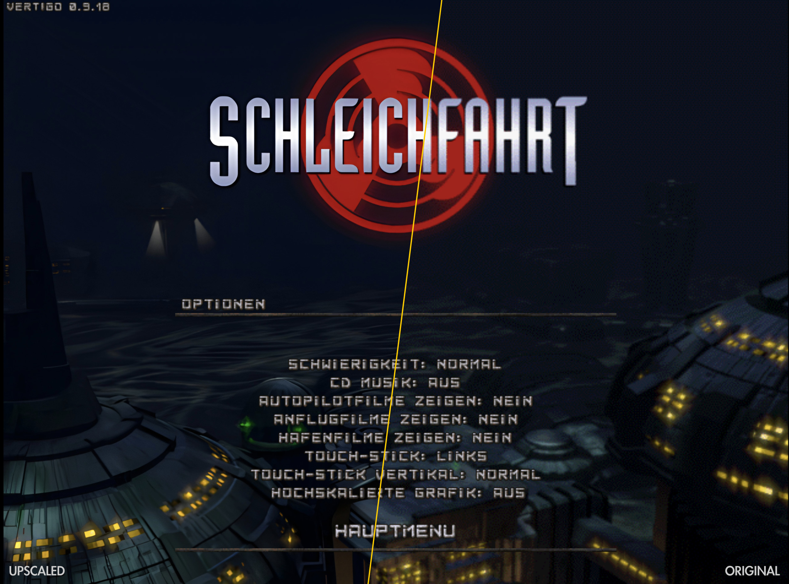
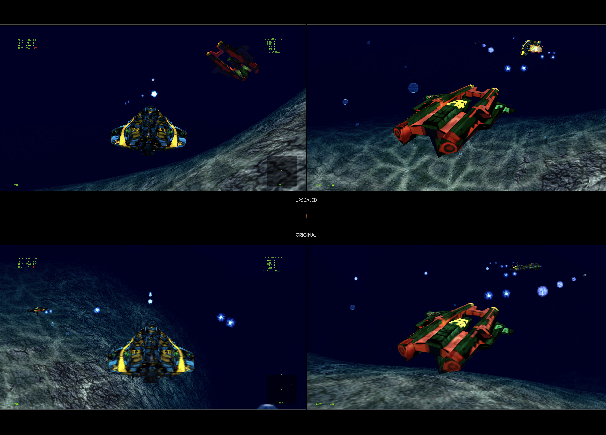

# Vertigo

[](https://github.com/andreashanft/vertigo/actions/workflows/build.yml)

In November 1996, „[Archimedean Dynasty](https://en.wikipedia.org/wiki/Archimedean_Dynasty)“, better known under its German title "[Schleichfahrt](https://de.wikipedia.org/wiki/Schleichfahrt_%28Computerspiel%29)", was released by *Massive Development*.

This repository is an open-source clone that faithfully recreates this 30 year old classic. It builds on [github.com/pnordhus/vertigo](https://github.com/pnordhus/vertigo), where many parts had been reimplemented years ago before the project was abandoned.

With the help of Claude Code, most open TODOs and missing features are now implemented. There is also an iPad version and a feasibility study of real 3D cockpits for an eventual VR port.

The game runs on current hardware and systems in modern resolutions, with an improved look (e.g. upscaled graphics) that keeps its style. For copyright reasons the repository contains no game data or binaries: the assets of an original English or German version (CD or GOG) are required.

The implementation is about **98% done**:

* Modern codebase and renderer for macOS, iOS (iPad), Linux and Windows (not playtested yet)
* English and German original or [modified](https://www.moddb.com/mods/archimedean-dynasty-augmented-mod) game data
* Menus, stations, dialogs, dock, upgrades, notebook, movies and music all work
* Missions are playable and the story can be progressed
* Keyboard, game controllers and touch on the iPad
* Experimental: 3D cockpits for widescreen and, in the future, VR

What's still missing are details and thorough playtesting, see [docs/ROADMAP.md](docs/ROADMAP.md).

## Contents

- [Downloads](#downloads)
- [Compiling](#compiling): [macOS](#macos-homebrew), [iPad](#ipad), [Linux](#linux), [Windows](#windows)
- [Game data](#game-data): [Saved games and settings](#saved-games-and-settings)
- [Features](#features)
  - [Upscaled graphics](#upscaled-graphics): [AI upscale](#ai-upscale), [HD font](#main-menu-hd-font), [Simple upscale](#simple-upscale)
  - [Game controllers](#game-controllers)
  - [Touch controls](#touch-controls)
  - [Views from outside](#views-from-outside)
  - [3D cockpits](#3d-cockpits)
- [Testing](#testing): [Mission sanity checks](#mission-sanity-checks)

# Downloads

Builds for Linux, macOS and Windows are in the Releases section on GitHub:

* `vertigo-<version>-linux-x86_64.tar.gz`: SDL 3 built in; needs OpenAL
  (`libopenal1`), OpenGL 3.2 and Ubuntu 24.04 or newer
* `vertigo-<version>-macos-universal.zip`: `Vertigo.app` for Apple silicon and
  Intel, macOS 13.3 or later. It isn't signed, so macOS refuses the first
  start: System Settings › Privacy & Security › Open Anyway starts it (or
  `xattr -dr com.apple.quarantine Vertigo.app`)
* `vertigo-<version>-windows-x86_64.zip`: `vertigo.exe` with `SDL3.dll` and
  OpenAL Soft's `OpenAL32.dll`, Windows 10 or later

The game data is added at the first start (see [Game data](#game-data)).

# Compiling

Vertigo needs SDL 3, OpenAL and GLM, and draws with OpenGL 3.2 (core profile)
or OpenGL ES 3.

```
mkdir build
cd build
cmake ..
make
```

`ctest` runs the tests of the game's own types (text, data values, images,
JSON, CD images and more).

## macOS (Homebrew)

```
brew install cmake sdl3 glm
mkdir build
cd build
cmake -DCMAKE_BUILD_TYPE=RelWithDebInfo ..
make
```

## iPad


The iPad version needs Xcode, CMake 3.24 or newer and GLM's headers
(`brew install cmake glm`), and runs on iPadOS 18.6 or later. CMake downloads
SDL's source release (checked against its SHA-256) and builds it for iOS;
OpenAL and OpenGL ES are the system's. To build for the simulator and install
it there:

```
cmake -S . -B build-ios -G Xcode -DCMAKE_SYSTEM_NAME=iOS
cmake --build build-ios --config Release -- -sdk iphonesimulator
xcrun simctl install booted build-ios/Release/Vertigo.app
```

For an iPad, open `build-ios/vertigo.xcodeproj` in Xcode and choose a team
for signing, or pass `-DVERTIGO_DEVELOPMENT_TEAM=<team ID>` (and if needed
`-DVERTIGO_BUNDLE_ID=<identifier>`) to the first command and build with
`-sdk iphoneos -allowProvisioningUpdates`. Xcode's `vertigo` scheme runs the
optimised RelWithDebInfo build; a Debug build is too slow to play.

The game data goes into Vertigo's folder in the Files app (On My iPad ›
Vertigo), which the Finder also shows when the iPad is connected to a Mac.
Copy a GOG installation there and Vertigo builds the game data from its CD
image `game.gog` and the installed files into `Game Data` (580 MB, kept out
of iCloud backups); the installation can go afterwards. Ready game data (see
below) works too, directly in Vertigo's folder or in a folder of its own. In
the simulator, copy it into the app's container:

```
cp -R <GOG installation or game data> "$(xcrun simctl get_app_container booted com.vertigo.Vertigo data)/Documents/"
```

Test mode takes its options there too, e.g.
`xcrun simctl launch booted com.vertigo.Vertigo s00101 --timeout 60`. The
simulator renders OpenGL ES in software: the 3D cockpit is too slow there, and
now and then a triangle close to the camera goes missing.

Missions are played by touch, with a hardware keyboard or with a game
controller. On keyboards without Esc and function keys, Cmd+. is Esc and Cmd
with 1 to 0, - and = is F1 to F12 (Ctrl on Windows and Linux); iPadOS can
also make Caps Lock an Esc key (Settings › General › Keyboard › Hardware
Keyboard › Modifier Keys). The on-screen keyboard comes up for a new game's
name.

An interruption (a call, Siri, the app switcher) or going to the background
pauses a mission; P, or continuing from the mission menu, goes on. The game's
sound mixes with other apps' audio and is silent with the silent switch.

## Linux

Ubuntu 24.04 has no SDL 3 package, so build SDL 3 first, as
[the workflow](.github/workflows/build.yml) does.

### Nix

With Nix and flakes enabled, build and start Vertigo with:
```
nix run github:pnordhus/vertigo
```

## Windows

With Visual Studio 2022 and CMake, the Visual Studio builds of SDL 3
(`SDL3-devel-<version>-VC.zip`) and OpenAL Soft (`openal-soft-<version>-bin.zip`)
and GLM's headers, as [the workflow](.github/workflows/build.yml) does:

```
cmake -S . -B build -A x64 -DSDL3_DIR=<SDL>/cmake -Dglm_DIR=<GLM>/share/glm -DOPENAL_INCLUDE_DIR=<OpenAL Soft>/include/AL -DOPENAL_LIBRARY=<OpenAL Soft>/libs/Win64/OpenAL32.lib
cmake --build build --config Release
```

`vertigo.exe` needs `SDL3.dll` and OpenAL Soft's `soft_oal.dll`, renamed to
`OpenAL32.dll`, next to it.


# Game data

Vertigo needs the complete game data, including the movies. A GOG installation
contains only part of it; the rest is in its CD image (`game.gog`, a raw
`MODE1/2352` track). The game data is a directory with `DAT`, `GFX`, `SFX`,
`TXT` and `VFX` from the CD's `SF` directory, with the installed files copied
on top.

Vertigo asks for it at the first start, and again whenever the remembered one
is incomplete. Given a GOG installation, or a directory with a CD image
(`.iso`, or `.bin` of a `MODE1/2352` track), it builds the directory itself as
`Game Data` next to the saved games, including the music from the CD's audio
tracks (or, for a rip with a file per track, by its `.cue`). `--data
<directory>` uses another directory for one run.

## Saved games and settings

Saved games (`save`) and settings (`settings.ini`) are kept in
`~/Library/Application Support/Vertigo/Vertigo` on macOS,
`%LOCALAPPDATA%\Vertigo\Vertigo` on Windows,
`~/.local/share/Vertigo/Vertigo` on Linux and the app's own folder on the
iPad.

A new game autosaves on arriving at a station, after each conversation and
before each mission. The notebook's LOAD / SAVE offers manual saves; a game
loaded from one keeps its own autosave up to date. Each save is a
`slot_<n>.des` file in `save`.

# Features

## Upscaled graphics

### AI upscale

An optional upscale with a newer AI model (Qwen Image 2.1 in ComfyUI) redraws
the pictures and textures with more detail and clean lettering. It runs outside
the game as a script, takes a few hours on a strong graphics card and builds on
the Real-ESRGAN upscale below. See [data/AI-upscale](data/AI-upscale/README.md).

### Main Menu HD Font

The silver font of the menus and screens is drawn from a recreated vector
version, sharp at any size. It can be fine-tuned with the font editor in
[data/font](data/font/README.md).

### Simple upscale

[Real-ESRGAN](https://github.com/xinntao/Real-ESRGAN), an image upscaler based
on machine learning, upscales the game's graphics locally within a few minutes:

- Full-screen pictures: stations, rooms, backgrounds, the main menu's title,
  the notebook and the cockpits' art (also for the 3D cockpits)
- Textures of the models and the effects' sprites
- Pictures that are mostly text, with Real-ESRGAN's model for animation, which
  keeps letters better (the sea and area maps, the autopilot's destinations,
  the credits)





#### How to enable

In the main menu's Options, click **Upscaled graphics: PREPARE**. It asks
before downloading Real-ESRGAN (the latest official release, ~52 MB, checked
against its checksum) into `Real-ESRGAN` next to the saved games. Upscaling
takes about 5-10 minutes in the background; clicking the line again stops it,
and it resumes where it stopped.

**Once finished, restart the game to use the upscaled graphics.** The set is
kept in `Game Data Upscaled` next to the saved games (see
[Saved games and settings](#saved-games-and-settings)).

The upscaler isn't available on the iPad: copy `Game Data Upscaled` from a
computer into Vertigo's folder (On My iPad › Vertigo in the Files app) and
switch it on in Options.

`vertigo --upscale` makes the set in a terminal, printing the progress. The
upscaler needs Vulkan (on macOS through Metal).

#### Caveats

Not upscaled are:
* The other fonts and the HUD's own art (pixel doubled, they stay sharp)
* The terrain (the upscaler breaks its seamless tiling)
* Movies and background animations

Small lettering on models and buildings can come out garbled.

## Game controllers

Missions can be played with a game controller (Xbox, PlayStation, Switch Pro
or MFi, through SDL), on the desktop and the iPad. Buttons are named after an
Xbox controller's. The left stick steers as far as it is pushed; as with the
original's joystick, forward lowers the nose. The buttons stand for the keys
in brackets, and LB held gives a second set:

| Control | In a mission | With LB held |
|---|---|---|
| Left stick | steer | |
| Right stick | look around in the 3D cockpit; in the look-at view move the camera round the boat | zoom the view from outside (up and down) |
| RT | fire the gun (Space) | |
| LT | fire a torpedo (Tab) | |
| RB | lock the target in the reticle (L) | |
| A | lock the nearest enemy (U) | autopilot (Alt+A) |
| B | drop a buzzer (D) | engine on or off (the key left of 1) |
| X | next torpedo (Enter) | debug overlay (Ctrl+D) |
| Y | next nav point (N) | lock the nav point (Alt+N) |
| D-pad up | 10 km/h faster, repeating while held (S) | the weapon page: gun, magazine, turrets in turn (F1–F4) |
| D-pad down | 10 km/h slower, the same (X) | armor and systems page (I) |
| D-pad left | stop (C) | the booster, while held (Q) |
| D-pad right | sonar on or off (R) | sonar zoom (Alt+R) |
| L3, R3 (press a stick) | full ahead, full astern while held (A, Z) | |
| Start | mission menu (Esc) | pause (P) |
| Back | turret menu (O) | the next cockpit or view from outside (V) |

In the mission and turret menus the d-pad highlights an option, A takes it and
B goes back. Elsewhere A is Return, B and Start are Esc: any button starts a
mission after its briefing, B or Start skips a movie, A confirms a new game's
name. Menus and stations take the mouse, or touch on the iPad.

## Touch controls

On a touch screen (the iPad) missions show their own controls over the
cockpit: from the start when no keyboard or game controller is connected,
otherwise once the screen is touched. A key or a controller's button hides
them again.

- A finger on the left part of the screen brings up a stick where it comes
  down; it steers as far as it is pushed (up lowers the nose).
- Under the right thumb: FIRE (held), and around it TORP (fire a torpedo),
  BUZZ (drop a buzzer), NEXT (the next torpedo) and LOCK (the nearest enemy);
  above them + and - change the speed by 10 km/h (repeating while held), and
  STOP stops.
- In the corners: MENU (the mission menu when the finger is lifted; held for a
  second it toggles the debug overlay), NAV (the next nav point), AUTO
  (autopilot), SONAR (on or off), TURR (turret menu) and VIEW (the next
  cockpit or view from outside, as V).
- A tap takes an option of the mission and turret menus.
- A tap on a status monitor changes its page: the weapon monitor steps through
  the gun, the magazine and the turrets to the overview (as F1-F4), the armor
  monitor switches to the system state and back (as I); Hiob's single monitor
  goes through all of them. In the 3D cockpit only with the head facing
  forward.
- In the 3D cockpit a finger dragged elsewhere turns the head; in the look-at
  view it moves the camera round the boat, and two fingers zoom the views from
  outside.

The main menu's Options, and the notebook's Options › Input devices, put the
stick on the right and the buttons on the left (Touch stick: RIGHT), and let
up raise the nose (Touch stick vertical: INVERTED).

## Views from outside

As in the original, the number pad offers outside views:

- 0: chase view behind the boat, with a few instruments
- 5: look-at view round the boat
- 1 and 7: the same of the locked target
- 9 and 3 zoom; 4, 6, 8 and 2 move the look-at view's camera round the boat

V steps through the 2D cockpit, the 3D one, and the chase and look-at views
of the boat and of the target (LB+Back on a game controller, VIEW on the touch
screen). In the views, dragging with the mouse or a finger moves the look-at
view's camera, and the mouse wheel (two fingers on a trackpad) or a pinch
zooms.

## 3D cockpits

Besides the original 2D cockpit art, Vertigo can show 3D models of the four
cockpits. The models come without their textures (`cockpits` next to the
program, built by the Blender scripts in
[data/3D-cockpits](data/3D-cockpits/README.md)). The first time a 3D cockpit
is shown, its texture is painted from the cockpit art of your game data in the
background (the 2D cockpit shows meanwhile); with the
[upscaled graphics](#upscaled-graphics) on, from the upscaled art of the set in
use (Real-ESRGAN's or the AI upscale's). The texture is cached in
`~/Library/Caches/Vertigo` on macOS, `~/.cache/vertigo` on Linux and
`AppData/Local/Vertigo/Vertigo/Cache` on Windows.

- `--cockpit 3d` (or `2d`) picks the cockpit for one run; Alt+V switches in a
  mission and saves the choice (setting `cockpit/mode`). Without a model for
  the boat's cockpit the 2D art is shown.
- A finished model, e.g. one textured with upscaled art by the scripts in
  data/3D-cockpits, takes the kit's place when it is in the folder
  `3d-cockpits` of the data directory (or the folder set as
  `cockpit/directory`). `--cockpit-dir 3d-cockpits-vector` takes them from
  another folder for one run (relative to the data directory), e.g. to compare
  texture variants; without a model there, the kit is used.
- The texture is 8192x8192 on the desktop and 4096x4096 on the iPad.
- In 3D the world uses the cockpit art's camera (`ViewAngle` 105° in the
  cockpit's DES file, wider than the 2D cockpit's view) and fills the whole
  window. The instruments are projected onto the model's screens.
- Mouse look: dragging with a mouse button (or on the trackpad) turns the
  pilot's head, up to 105° to the side, 65° up and 55° down; on release the
  head turns back to the front. `--look=60,-10` fixes the head at 60° left and
  10° down for the whole run, e.g. for screenshots.
- Cockpit shake: `--shake 0.5` (setting `cockpit/shake`, default 1) scales it,
  0 turns it off. `--trace` with the player's id prints the head offset.


# Testing

Vertigo can start a mission directly from the command line:

```
vertigo s00101 --boat 2050 --equip GUN=3083,TUR1=3074 --overlay --timeout 60
```

- `--boat` picks the boat (2049 Hiob, 2050 Gator, 2051 Zorn, 2052 Succubus),
  `--equip` installs items (`--list-items` lists them). Otherwise the
  chapter 1 boat is used.
- `--overlay` shows the debug overlay with the player's state and a label for
  every object (toggle with Ctrl+D, Cmd+D on macOS and the iPad, LB+X on a
  game controller, or by holding MENU on the touch screen). Yellow labels are
  detected by the sonar, green ones enabled but not detected, red ones not
  enabled yet. Its FPS line shows the frames per second of the last second,
  the average and the longest time between frames, and the CPU time per frame
  (updating and drawing, without waiting for the screen or the GPU), in
  milliseconds; not with `--fixed-step`. It ends in DEBUG BUILD for an
  unoptimised build, which draws several times slower.
- `--destroy 2064,2068` destroys these units (scenario ids, shown by the
  overlay) one second into the mission, to test objectives and conditions.
  The player's id destroys the player; for areas and nav points it counts as
  reaching them.
- `--collapse 2050` collapses these units' energy defence one second in:
  boats drift helplessly with a slow spin for a few seconds, as after a Flash
  Shark's hit; tanks stop, gun towers lower their guns and torpedo towers stop
  launching.
- `--trace 2062,2055` prints these units' map cell, height above ground,
  speed, shield and current order every second; the player's id prints the
  player with the water current at its position and the four shield sides.
- `--headless` runs the mission without a window and sound, in simulated time
  as fast as possible (use it with `--timeout`; all test times are then
  mission seconds). Automated runs with a window and `--timeout` don't take
  the focus; on macOS they run in the background, without a Dock icon and
  without keyboard input other than `--keys`.
- `--keys 2=Esc,3=2,4=1` presses keys at the given seconds, e.g. to drive the
  Esc menu (here: restart the mission). `5=Space/0.1` holds a key for 0.1 s;
  keys like Space (fire) or the arrows need that to have an effect. `Num+0`
  is the number pad's 0.
- `--pad 2=Start,3=A,4=RT/1,5=LB+A,6=LeftY:-0.5/2` works a virtual game
  controller at the given seconds: buttons by the names above (A, B, X, Y, LB,
  RB, LT, RT, L3, R3, Start, Back, Up, Down, Left, Right), held for 0.1 s or
  the given seconds, several at once with `+` (pressed in that order); a
  stick's axis (`LeftX`, `LeftY`, `RightX`, `RightY`, y down) at a value from
  -1 to 1, for good or for the given seconds. Real controllers are ignored
  then, and automated runs without `--pad` don't look for them.
- `--fire 2050` lets units fire their guns; towers and tanks aim at the
  player.
- `--near 2050` enables this unit and starts the player 40 m from it, looking
  at it, e.g. to watch it with `--screenshot`.
- `--start 76,76` starts the player at this cell of the map, at the
  scenario's height above the ground and heading; `--start 198,126,10,6` sets
  those too, in the scenario's units (card 0 north, 2 east, 4 south, 6 west),
  e.g. to take a screenshot where one of the original was taken.
- `--drive 2053=60,2055=40:-0.5` lets boats move at a speed in km/h, turning
  at a fraction of their maximum turn rate (the sign picks the direction),
  instead of following their orders.
- `--screenshot 3=front.png` saves the window as PNG at the given mission
  seconds (not with `--headless`).
- `--fixed-step` advances the mission by 20 ms per frame instead of by the
  real time, so runs with a window repeat exactly, frame by frame (test times
  are then mission seconds). Screenshots of two builds can be compared pixel
  by pixel this way, e.g. after changes to the renderer.
- `--click 2=320,300` clicks at the given seconds at a point of the 640×480
  screen (the mouse moves there first); `--click 2=100,50>300,80` drags from
  the first point to the second.
- `--touch 2=0.9,0.8/1` puts a finger on the touch screen at the given
  seconds, at a point given as fractions of the window's width and height,
  for 0.1 s or the given seconds; `--touch 3=0.2,0.7>0.2,0.6/2` moves it to a
  second point within 0.1 s (e.g. the stick). Repeat the option for more
  fingers at once.
- Without a mission, `--timeout`, `--keys`, `--click` and `--screenshot`
  work in the main menu and the game it starts, in seconds since the start,
  e.g. `vertigo --click 1=320,240 --screenshot 3=menu.png --timeout 4`.
- `--seed 5` picks the random numbers (default 1), so a run repeats exactly.
  Compare runs only between builds of the same build type: an optimised build
  rounds floating point differently, and missions can end differently.
- The mission ends as soon as it is accomplished (no need to press Alt+A), 10
  seconds after it failed, or 3 seconds after the player was destroyed. The
  exit code tells how it ended: 0 success, 1 failed, 2 aborted (Esc menu or
  window closed), 3 `--timeout` reached, 4 player destroyed. A summary line
  with the time, enabled units and radio messages is printed at the end:

  ```
  $ vertigo s01805 --destroy 2064,2068,2069,2071 --timeout 5
  s01805: timeout after 5.006 s, 43/51 units enabled, 2 radio messages
  ```

In a mission, Ctrl+D (Cmd+D on macOS) shows debug information and Ctrl+K
(Cmd+K on macOS) skips the mission as if it had been accomplished.

## Mission sanity checks

`vertigo --check [mission...]` loads all missions (or the given ones) and lists
everything the loader skips or ignores: unsupported object types, unread
settings and sections, and conditions that can't be resolved. The output is
kept in [docs/mission-check.txt](docs/mission-check.txt); regenerate it after
changes to compare:

```
build/vertigo --check > docs/mission-check.txt
```
