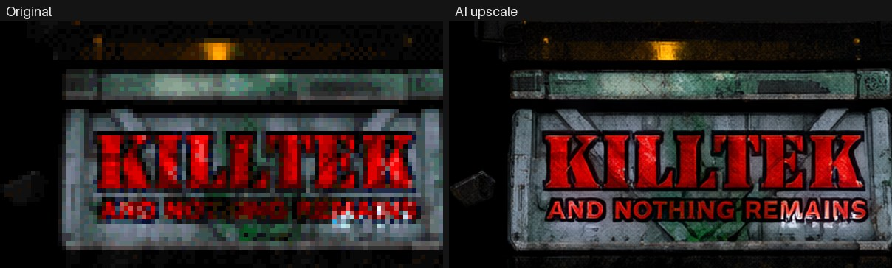
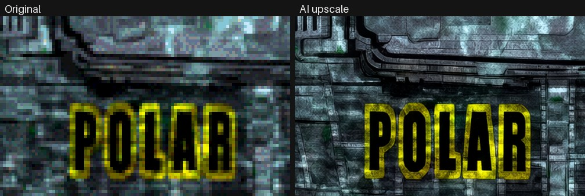
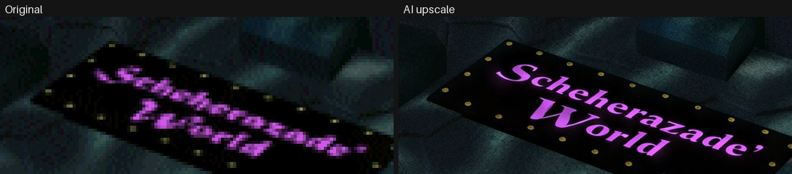
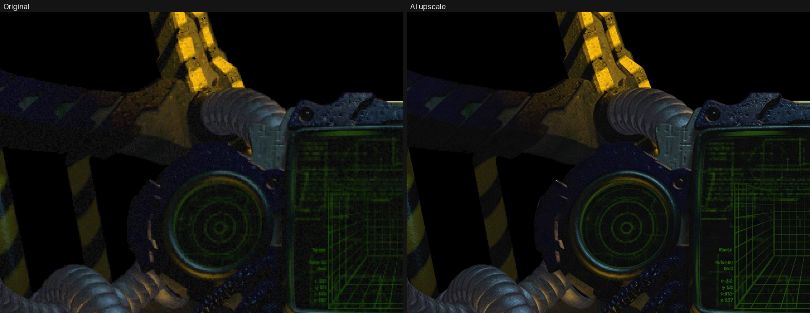
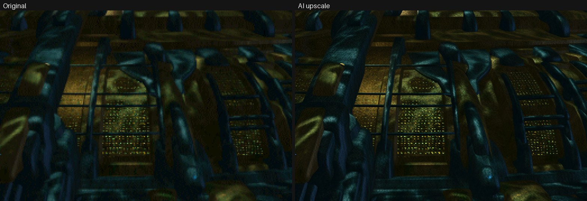
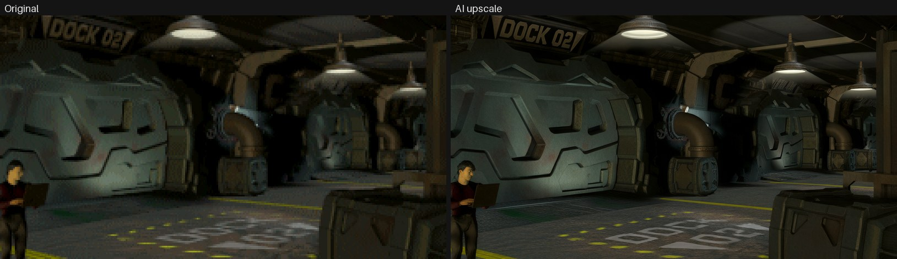

# AI upscale

A second, optional upscale of the game's graphics with a newer AI model,
[Qwen Image 2.1](https://github.com/QwenLM/Qwen-Image) in [ComfyUI](https://github.com/comfyanonymous/ComfyUI).
It redraws each picture and texture at four times its size, with real detail and clean
letters.

It runs outside the game, as a script, and takes a few hours on a strong graphics card. It
creates a new set the game uses just like the set of the built-in upscale.

Nothing here ships game data. The scripts read your own game data. Everything they make goes
to `work/` (ignored by git).

## Examples

Original (enlarged) on the left, AI upscale on the right.

Lettering on a texture:



A boat's name on its hull texture:



A sign in a station picture:



A 2D cockpit:



A station seen from outside:



A room inside a station:



## What you need

- Vertigo, built from this repository, and the game data.
- The Real-ESRGAN set, made by the game: Options › **Upscaled graphics: PREPARE**, or
  `vertigo --upscale`. One from an older Vertigo is brought up to date there first
  (**UPDATE**), and the steps below run again.
- Python 3.9 or newer, and curl.
- ComfyUI 0.42 or newer with these models (the names are in `workflows.py`):
  - `diffusion_models/qwen_image_2.1_int8_convrot.safetensors`
  - `text_encoders/qwen3vl_8b_int8_convrot.safetensors` (Qwen3-VL, which also reads the text back)
  - `vae/qwen_image_2.1_vae_bf16.safetensors`
- A reasonable strong graphics card with enough RAM to run the models. The whole set takes a few hours.
- macOS or Linux for the first step (`export`). ComfyUI can run on another machine.

## Setup

```sh
cd data/AI-upscale
python3 -m venv venv
venv/bin/pip install -r requirements.txt
```

If ComfyUI runs on another machine, start it there with `--listen` and tell the scripts where it is:

```sh
export COMFYUI_URL=http://192.168.1.20:8188
```

Then check that ComfyUI can be reached and has the models:

```sh
venv/bin/python aiupscale.py check
```

## Usage

Run the steps in this order. Each one can be stopped and started again.

1. `venv/bin/python aiupscale.py export`
   Gets the game's pictures and textures as the game decodes them (3444 files, most of them the
   depot's movie pictures), into `work/originals`. It runs Vertigo's own upscale with a stand-in
   for Real-ESRGAN, in a throwaway home folder. It finds the game data like Vertigo does, or
   takes `--data DIR`.
2. `venv/bin/python aiupscale.py prepare`
   Copies the game's Real-ESRGAN set into `work/esrgan`. The AI set is built on it.
3. `venv/bin/python aiupscale.py names` (optional)
   Finds which picture file each original is, for the review page (`config/names.json`).
4. `venv/bin/python aiupscale.py texts` (optional, `config/texts.json` already has the texts)
   Qwen3-VL proposes the texts in the pictures. Look at the sheets in `work/texts-sheet-*.png`
   and put the correct ones into `config/texts.json`.
5. `venv/bin/python aiupscale.py run`
   The upscale itself, into `work/out`. It takes hours; started again, it goes on where it
   stopped. `run KEY ...` does single images.
6. `venv/bin/python aiupscale.py set ai`
   Makes the set `work/sets/ai`: the Real-ESRGAN set with the AI copies in place.
7. `venv/bin/python aiupscale.py review`
   Makes `work/review.html`. Open it in a browser. Hold the mouse button on an image to see
   the original instead, enlarged to the same size, or the Real-ESRGAN copy. Choose which at
   the top of the page.
8. `venv/bin/python aiupscale.py use ai`
   Switches the game to the set (quit the game first). The Real-ESRGAN set is kept aside.
   `use esrgan` switches back. For the iPad, copy `work/sets/ai` to Vertigo's folder there
   as `Game Data Upscaled`.

`compare KEY X Y W H` makes a picture like the examples above.

## How it works

- The game finds an upscaled copy by a hash of the image it decodes. So the pipeline makes
  files with the same names, at exactly four times the size.
- Each image is enlarged 4× and cut into tiles of about one megapixel. Qwen Image 2.1 draws
  each tile anew, with the tile as its reference. At this size nothing moves.
- Textures (256×256) are one tile. Most rooms fit into one tile too. Full-screen pictures take
  nine tiles, blended at their overlaps.
- Texts are named in the prompt. Qwen3-VL reads each one back. If it doesn't read right, the
  tile is drawn again with another seed, up to five times.
- Small texts can get a close-up of their own. Upside-down ones are turned upright for it and
  turned back.
- Each tile's position is measured against its input. A tile that moved is drawn again.
- The colours are matched to the original, so that the result keeps its look.
- Some station pictures have vertical streaks or a dotted dithering in their open water. The
  pipeline finds both and smooths them away.
- On the sea maps only the terrain is redrawn. Labels, lines and frames stay from Real-ESRGAN.
- Some images keep the Real-ESRGAN copy: the effects' sprites with transparency, smoke and
  fire (the AI does not improve them), the autopilot's destinations, the credits, the cursor
  and the depot's pictures, icons and movies (a movie's pictures redrawn one by one would
  flicker).

## The config files

All of them are keyed by the image's hash, the name of its file in the set.

- `config/texts.json`: the texts in each image. An entry has `text` and `box` (x1, y1, x2, y2
  in the original's pixels). Optional: `note` (how it is written, e.g. "written vertically"),
  `zoom` (draw it again from close up) and `turned` (it is upside down). An entry with
  `hint` instead of `text` describes a part, e.g. "a skull emblem (a skull, not a face)".
- `config/esrgan-regions.json`: parts of an image that keep the Real-ESRGAN copy, as boxes, or
  `"all"`.
- `config/streaks.json`: pictures whose water to smooth, with points in the water. Usually
  empty: the pipeline finds the streaks by itself.
- `config/names.json`: which picture file each hash is.

The config was made with the German GOG version. With other game data a few images may have
other hashes; they are upscaled all the same, only without their texts and hints.

## Limits

- The fonts and the terrain are not upscaled a they did not improve
- Very small text can still come out wrong. Check the review page and add or fix entries in
  `config/texts.json`.
