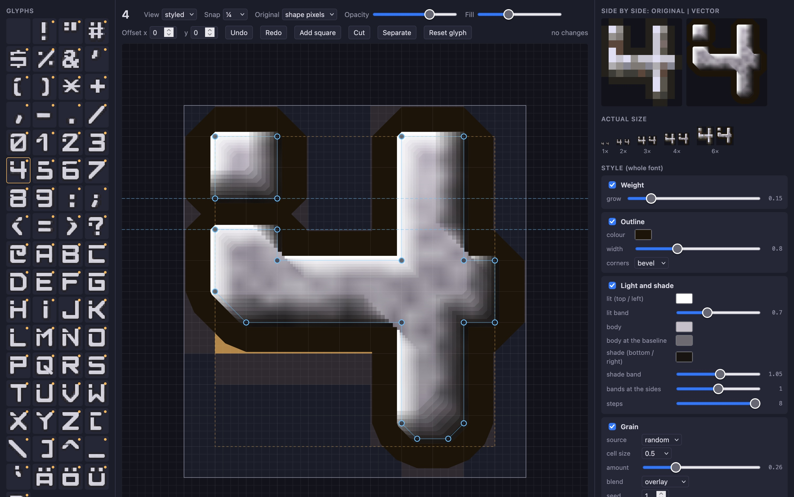

# Font editor

A vector font to recreate the game's main menu silver font in high res. The font
editor is a browser tool to modify the vector font on a glyph basis. With it, the shape 
of a letter on a pixel level as well as the weight, outline, light and shade,
and grain layers that give the vectors the look of the game's font, can be edited.



| File | |
|---|---|
| `index.html` | the editor |
| `server.py` | serves the editor and saves its edits |
| `glyphs.json` | the starting shapes |
| `vertigo-mono.json` | the current shapes and style, written by the editor |
| `vertigo-mono-edit.svg` | the shapes as an SVG atlas, 16 glyphs per row |
| `vertigo-mono-styled.svg` | the atlas with outline, light and shade, and grain |
| `originals.py` | writes `originals.json`, the game's glyphs to compare against and its main menu |

The game data is not part of the repository, so `originals.json` is made
locally from an installed copy of the game (the folder that holds `GFX` and
`TXT`), and needs Pillow:

```bash
python3 data/font/originals.py "<game data folder>"
```

Then start the server and open http://127.0.0.1:8765/:

```bash
python3 data/font/server.py
```

The editor shows a mock of the game's main menu, cropped to its items, with the
font as Vertigo draws it; hold Space to see the game's font there instead. A
shape can be cut in two between two of its selected points (C), and Separate
cuts a glyph's shapes apart where they touch themselves, so two parts never
need a bridge of no width between them (it shows in the outline and the weight).

The editor saves every change to `vertigo-mono.json` and the two SVGs. Reset glyph
returns a glyph to its shape in `glyphs.json`.

## In Vertigo

With the upscaled graphics on, Vertigo draws the main menu fonts (large, medium
and small) from `vertigo-mono.json`, which the build copies next to the program
(`font/vertigo-mono.json`, in `share/vertigo/font` when installed): each glyph
over the box of the game's glyph it replaces, so text keeps the game's widths,
in the editor's style, eight texels per game pixel. The large font's glyphs are
brightened inside (gamma 1.4) to the game's lighter large font; the medium and
small fonts
take the glyphs shrunk to their lower boxes, at 90% of their height, centred on
them. The game's small letters
are its capitals, so they take the capitals' vector glyphs; a glyph without a
vector version keeps the game's pixels. After editing, building copies the file
again.
